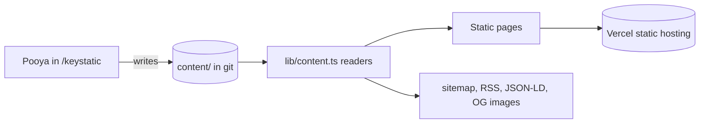

# PRD: freelance-site, Pooya's services site with a CMS

Status: draft for review
Shared rules: [STANDARDS.md](STANDARDS.md)

## 1. Overview

Pooya needs a credible home base to link from Upwork, Contra, and LinkedIn. The site does two jobs:
- It explains what he offers and how to hire him.
- It proves he builds fast, SEO-ready Next.js sites whose content can be edited without touching code.

**Audience:**
- Prospective clients: founders, small businesses, agencies.
- Platform reviewers, for example on Toptal or Contra.
- Search engines and AI answer engines.

## 2. Goals and non-goals

**Goals**
- A visitor understands the offer within 5 seconds and has an obvious way to get in touch.
- Case studies and posts show how Pooya thinks, not just what he lists.
- Content (services, work, posts, site settings) is edited in a CMS admin UI.
- Excellent technical SEO and Lighthouse scores, documented in the README as proof.

**Non-goals**
- A contact form backend. The site uses mailto and a booking link.
- Analytics, i18n, and a hosted CMS. The README explains how Sanity could replace Keystatic.

## 3. User stories

| # | As a... | I want to... | So that... |
|---|---------|--------------|------------|
| 1 | prospect | see the offer and a CTA immediately | I know if he fits my project |
| 2 | prospect | browse services with scope and starting prices | I can judge cost and fit |
| 3 | prospect | read case studies and see live demos | I trust he can deliver |
| 4 | prospect | reach him in one click | contacting him is easy |
| 5 | Pooya (editor) | add a post or case study in an admin UI | I don't have to edit code |
| 6 | search / AI engine | read clean metadata, structured data, and a sitemap | the site gets indexed and cited correctly |

## 4. Functional requirements

### 4.1 Pages
- **Home**, with these sections:
  - hero: one-line offer, short subline, primary CTA "Start a project", secondary "See my work"
  - the 4 services
  - selected work (3 cards)
  - how I work (4 steps: short call, written plan, small milestones, handoff)
  - short about
  - closing contact CTA
- **`/services` and `/services/[slug]`.** Each service page covers: who it's for, what's included, typical timeline, a starting price, and related work.
- **`/work` and `/work/[slug]`.** Each case study covers problem, approach, stack, outcome, and links (live demo, repo).
- **`/blog` and `/blog/[slug]`**, with reading time and date.
- **`/about`**: background, how he works, availability (evenings and weekends, Eastern Time).
- **`/contact`**: mailto, booking link, and what to include in a first message.
- **Custom 404.**

### 4.2 CMS (Keystatic)
- Keystatic runs in local (git-based) mode, with the admin UI at `/keystatic` during development.
- Collections and singleton:

  | Collection | Fields |
  |---|---|
  | `services` | title, slug, summary, body, startingPrice, timeline, order |
  | `work` | title, slug, summary, body, stack[], liveUrl, repoUrl, featured, order |
  | `posts` | title, slug, description, date, body, draft |
  | `settings` (singleton) | headline, subline, availability note |

- Content lives in the repo under `content/`. Pages read it at build time and are statically generated.
- Drafts are excluded from production builds.

### 4.3 Seed content
All seed content comes from Pooya's own profile notes, which are kept outside this repo. No invented facts or metrics.
- **Services:**
  - MVP and feature builds
  - fast, SEO-ready Next.js websites
  - AI assistants for your website (slug `ai-features`)
  - fixing and speeding up React/Next.js apps
- **Work:**
  - shop-search
  - this site
  - docs-chat
  - one public-level case study, "Rebuilding a large marketplace search experience": 150k+ listings, 50+ filters, saved searches and compare, a React/TypeScript rewrite, a NestJS BFF, OpenSearch, and LLM natural-language filters with validation and evals. Modest and factual.
- **Posts** (about 500 words each, practical, in his voice):
  - "How I test an LLM feature before shipping it"
  - "Next.js performance checklist for small business sites"

### 4.4 SEO and discoverability
- **Metadata:** set per page with the Metadata API (title template "%s | Pooya Nikbakht", description, canonical URL).
- **Social cards:** Open Graph and Twitter cards. Each page gets a dynamic OG image from `next/og`, using the brand tokens.
- **Crawling and feeds:**
  - `sitemap.ts`, built from CMS content
  - `robots.ts`
  - an RSS feed at `/blog/rss.xml`
- **JSON-LD structured data:**
  - Person and ProfessionalService on Home
  - Service on service pages
  - BlogPosting on posts
  - BreadcrumbList on nested pages
- **Markup:** semantic HTML, one h1 per page, descriptive link text, and alt text on images.

### 4.5 Config
- `site.config.ts` holds these values, each marked TODO:
  - name
  - email: placeholder `hello@example.com`
  - domain
  - GitHub, LinkedIn, Upwork, and Contra URLs
  - booking URL
- His work email appears nowhere in the repo.

## 5. Non-functional requirements

- Lighthouse 95+ in Performance, Accessibility, Best Practices, and SEO, on mobile and desktop.
- Minimal client JS: the only client component is the mobile nav toggle.
- No layout shift: fonts load through `next/font`, and images have fixed dimensions.
- An initials monogram stands in for a photo. No stock or fabricated headshot.
- Follows the shared quality bar for mobile, accessibility, and dark mode.

## 6. Architecture

Key files: `keystatic.config.ts`, `site.config.ts`, `lib/content.ts`, `lib/seo.ts`, `app/(site)/...` route groups, `app/opengraph-image.tsx`, `app/sitemap.ts`, `app/robots.ts`.

## 7. Acceptance criteria

- `npm run lint` and `npm run build` pass, and the build output shows content routes as static.
- With the production server running, curl checks pass on:
  - `/sitemap.xml`
  - `/robots.txt`
  - `/blog/rss.xml`
  - an OG image route
  - JSON-LD on Home and on one post
- In dev, `/keystatic` loads, and editing a post updates the page.
- Lighthouse scores are measured and reported in the README, if headless Lighthouse runs.
- Playwright screenshots at desktop and 375px wide are saved to `docs/screenshots/`.
- None of the copy contains em dashes.

## 8. Milestones

1. Scaffold, design tokens, layout, nav, footer.
2. Keystatic schema, seed content, content readers.
3. Pages.
4. SEO layer: metadata, OG images, JSON-LD, sitemap, RSS.
5. Lighthouse pass, screenshots, README.

## 9. Risks

| Risk | Mitigation |
|------|-----------|
| Keystatic not yet compatible with Next 16 | Pin the Next version Keystatic supports; if that fails, fall back to MDX with zod-validated frontmatter and document it |
| Copy sounds generic | Write from his real profile and tone rules; concrete examples over adjectives |
| Placeholders left in production | Every placeholder is marked TODO in `site.config.ts` and listed in the README |

## 10. Decisions

- **Domain:** this site becomes the new `pooya.website`, replacing Google Sites. Until it's ready, it lives on its free `*.workers.dev` URL, and `www.pooya.website` stays on Google Sites. The useful content from the current Google Sites page moves into `/about`. Pooya will share that content.
- **Hosting:** Cloudflare Workers (OpenNext). The free plan allows commercial use, which matters for a site that brings in client work.
- **Prices:** service pages show "from $X" prices, matching his freelance packages. The values are editable in the CMS.
- **Projects:** the work section links each demo to its subdomain (`shop.`, `bot.`) once those are live. Until then, links point to the free URLs, set in config.
