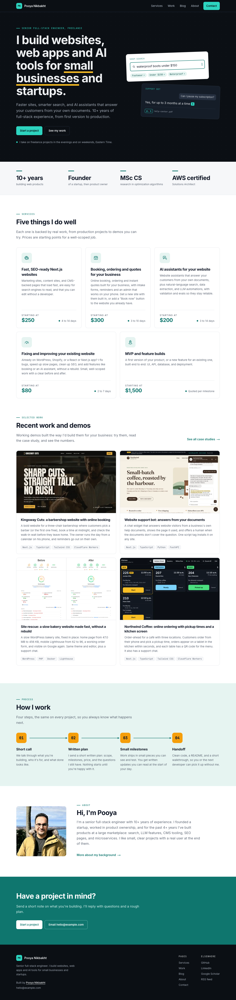
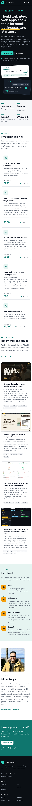
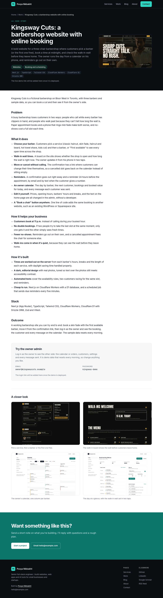
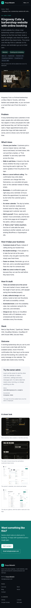
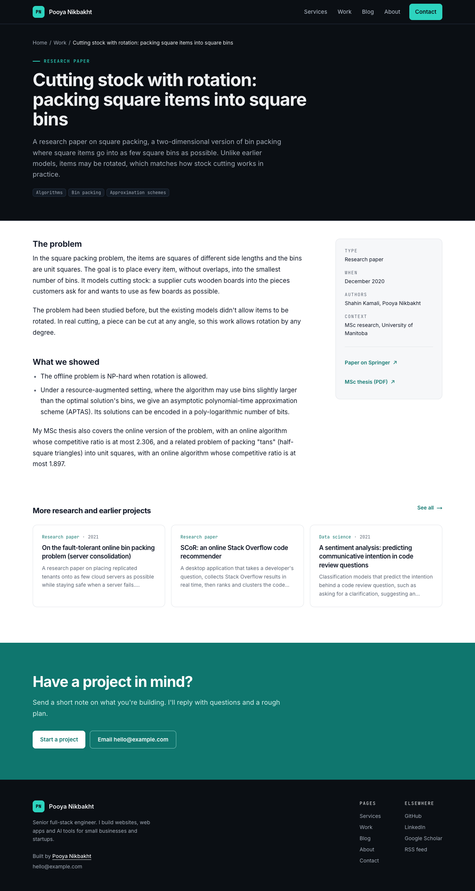
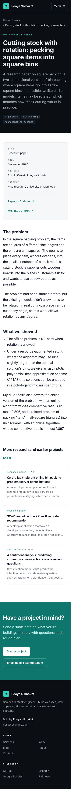
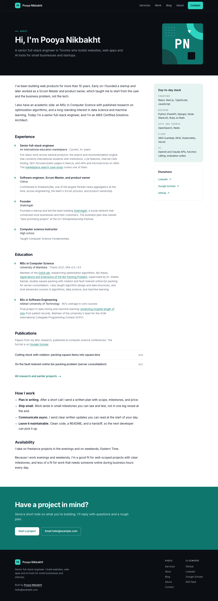
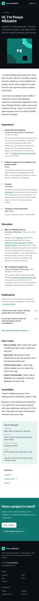
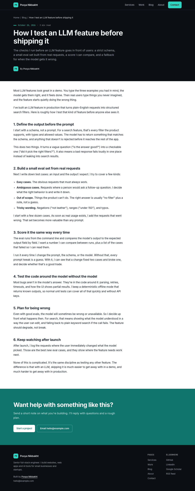
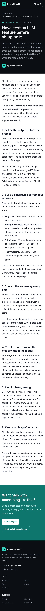

# freelance-site

Pooya Nikbakht's services site: what he offers (five services), how to hire him, case studies, his research and earlier projects, his background, and a small blog. It is also a working example of the "fast, SEO-ready Next.js website" service. Pages are statically generated with Next.js 16, content is edited in a Keystatic admin UI and stored as files in this repo, contact messages land in a small private inbox backed by Cloudflare D1, and the site runs on Cloudflare Workers through OpenNext.

It's built for prospective clients (founders, small businesses, agencies), for reviewers on freelance marketplaces, and for search and AI answer engines.

## Case studies

Listed on `/work` in this order (the first four are featured on the home page):

1. **Kingsway Cuts**: a barbershop website with online booking by barber, walk-in wait times, an owner calendar and reminders. Featured.
2. **Website support bot** (docs-chat): answers visitors from a business's own documents. Featured.
3. **Site rescue**: a slow WordPress bakery site fixed in place, with measured Lighthouse before and after. Featured.
4. **Northwind Coffee ordering**: café order-ahead with pickup times, a live kitchen screen and QR menus. Featured.
5. **Harbourview Physio**: a clinic website with booking and online intake forms.
6. **Maple Paws Vet**: a vet clinic website with booking by pet, pet records and vaccination reminders.
7. **Brightside Cleaning**: an instant quote calculator with a leads inbox.
8. **Paperwork AI**: invoices, receipts and forms into checked, exportable rows.
9. **shop-search**: natural-language product search.
10. **Marketplace search**: a public-level case study of production work.
11. **This site**.

Each entry has one or more categories (a multi-select in Keystatic, defined in `lib/categories.ts`): Websites, AI solutions, Booking and scheduling, Online ordering, Quotes and leads, Dashboards and admin, Fixing and improving, MVPs. `/work` has a filter with counts that links to a static page per category, `/work/category/<value>` (for example `/work/category/booking`), so it works without JavaScript. `/work?category=booking` redirects there.

The five small-business demos (Kingsway, Harbourview, Maple Paws, Northwind, Brightside) have no repository link, and each shows a "Try the owner admin" box with its demo login, set in `site.config.ts`.

Then "Research and earlier projects". Thumbnails and gallery images are real screenshots from each project's `docs/screenshots/`, cropped to 16:10 and saved as WebP at 640 and 1200px in `public/work/`. Thumbnails are mapped in `components/work-media.tsx`; extra screenshots under a case study are in `components/work-gallery.tsx`.

## Screenshots

| | Desktop | Mobile (375px) |
|---|---|---|
| Home |  |  |
| Case study (Kingsway Cuts, with its screenshot gallery) |  |  |
| Research |  |  |
| About |  |  |
| Post |  |  |

## Lighthouse

Measured with headless Lighthouse 13 against `npm run build && npm start` on a local machine (no CDN).

| Page | Mode | Performance | Accessibility | Best Practices | SEO |
|---|---|---|---|---|---|
| Home | Mobile | 96 | 100 | 100 | 100 |
| Case study | Mobile | 99 | 100 | 100 | 100 |
| Post | Mobile | 98 | 100 | 100 | 100 |
| Home | Desktop | 100 | 100 | 100 | 100 |
| Case study | Desktop | 100 | 100 | 100 | 100 |
| Post | Desktop | 100 | 100 | 100 | 100 |

## Architecture

```mermaid
flowchart LR
  Local[Keystatic in npm run dev] -->|writes files| C[(content/ in git)]
  Remote[Keystatic at /keystatic, GitHub mode] -->|commits| C
  C --> R[lib/content.ts readers]
  R --> P[Static pages]
  R --> SEO[sitemap, RSS, JSON-LD, OG images]
  P --> B[next build]
  SEO --> B
  B --> O[OpenNext adapter]
  O --> W[(Cloudflare Workers + static assets)]
  Visitor[Contact form] --> API[/api/contact]
  API -->|save first| D1[(D1: messages)]
  API -->|then email| Resend
  D1 --> Inbox[/admin/messages, GitHub sign-in]
```

| Path | What it does |
|---|---|
| `site.config.ts` | Name, email, domain, social links, booking link, demo URLs. Every placeholder is marked TODO. |
| `keystatic.config.ts` | CMS schema: `services`, `work`, `research`, `posts` collections and the `settings` and `about` singletons. Local storage in development, GitHub storage in production. |
| `content/` | The content itself: Markdoc files with YAML frontmatter, plus `settings.yaml` (headline, availability, header taglines) and `about.yaml` (everything on `/about`). |
| `lib/content.ts` | Typed readers built on the Keystatic reader API. Drafts are filtered out of production builds. |
| `lib/seo.ts` | Metadata helper (title template, description, canonical, Open Graph, Twitter) and JSON-LD builders. |
| `lib/og.tsx` | Shared `next/og` card using the brand tokens. Each route has a small `opengraph-image.tsx` that calls it. |
| `app/(site)/` | All public pages, inside a route group that adds the header and footer. |
| `next.config.ts` | Local Cloudflare bindings for `next dev`, noindex headers for the admin, the image loader, and permanent redirects from the old Google Sites URLs. |
| `app/sitemap.ts`, `app/robots.ts`, `app/(site)/blog/rss.xml/route.ts` | Crawling and feeds, built from CMS content. |
| `app/keystatic/`, `app/api/keystatic/` | The content editor and its API. Always on in development; in production only when the Keystatic GitHub settings are present (see "Edit from anywhere"). |
| `app/admin/`, `app/api/admin/auth/` | The private dashboard and messages inbox, and its GitHub sign-in. |
| `lib/admin/` | Sign-in config, signed session and state tokens (Web Crypto), and the GitHub OAuth flow. |
| `lib/messages.ts`, `lib/db.ts`, `migrations/` | D1 storage for contact messages and its schema. |
| `tests/` | Vitest unit tests (`npm test`). |

Structured data: `Person` (with `alumniOf` for both universities and `sameAs` for GitHub, LinkedIn, and Google Scholar) and `ProfessionalService` on Home, `Service` on service pages, `BlogPosting` on posts, `CreativeWork` on case studies, `ScholarlyArticle` or `CreativeWork` on research pages, and `BreadcrumbList` on every nested page.

## Key decisions and trade-offs

- **Fully static public pages.** Every content route is prerendered (`○` or `●` in the build output) and dynamic segments set `dynamicParams = false`. No runtime content reads. Only the contact API, the admin, and the editor run on the Worker.
- **Keystatic: local in development, GitHub in production.** `npm run dev` edits files in `content/`. In production the same editor at `/keystatic` saves each change as a commit to the repo, and Workers Builds redeploys. The editor and its API are in the production build but answer 404 until the GitHub settings are present, so a fresh deploy exposes nothing. The editor UI renders in the browser only (`ssr: false`), which keeps it out of the Worker bundle. Keystatic hard-codes its paths, so the editor stays at `/keystatic` and `/admin` links to it.
- **One admin entry, signed in with GitHub.** `/admin` (dashboard and inbox) uses a small GitHub OAuth flow written on `fetch` and Web Crypto, with an allowlist of GitHub accounts. No passwords to manage, and the GitHub token is never stored. In production the editor also asks for this sign-in first; Keystatic's own GitHub sign-in then controls who can write to the repo.
- **Save, then email.** Contact messages go into D1 before the email is sent, so a Resend outage loses nothing and the inbox shows which emails failed. Only a salted hash of the sender's IP is kept.
- **Markdoc for bodies.** Keystatic's Markdoc field stores plain text files that read well in a diff and render on the server with no client JS.
- **Two small client components.** The mobile menu toggle and the contact form are the only `"use client"` files; `/contact` itself is still prerendered. Fonts load through `next/font` (Inter and JetBrains Mono).
- **Calm, flat graphics without weight.** The look is flat (no gradients or shadows) and gets its identity from colour blocks: a dark hero and page headers, a tinted process band, and a solid teal call to action. Decoration is kept low: amber appears only as the hero underline and the process step numbers, and there are no decorative patterns. The two-card hero "work collage", service icons, and the marketplace illustration are HTML and inline SVG, so they cost no requests. The only raster images are the portrait, the case study thumbnails, and two small case study galleries, pre-optimized to WebP at 640 and 1200px and served through `next/image` with a small custom loader (`lib/image-loader.ts`), so no image optimization service is needed on the Worker. Every image has explicit sizes, so nothing shifts the layout.
- **Research as its own collection.** The seven research papers and earlier projects from the old Google Sites site are a separate `research` collection, not a flag on `work`: they need different fields (authors, type, year, a list of links) and a quieter card with no thumbnail. They live under `/work/research/<slug>` with the old slugs, so every old `/projects/<slug>` URL gets a one-hop permanent redirect.
- **Redirects in `next.config.ts`.** `redirects()` returns 308s for `/home`, `/projects`, and each `/projects/<slug>`. OpenNext compiles them into the Worker's routing layer, so they behave the same on Cloudflare as under `next start` (checked locally with `wrangler dev` after `opennextjs-cloudflare build`).
- **Demo links in config, not the CMS.** `site.config.ts` overrides `liveUrl` and `repoUrl` for the demo projects, so deploy URLs (free `*.workers.dev` first, then `shop.` and `bot.` subdomains) change in one place.
- **A real photo, lightly edited.** Cropped to head and shoulders with slightly calmer colour; no stock or generated headshot.
- **Cloudflare Workers over Vercel.** The Workers free plan allows commercial use; Vercel Hobby doesn't.
- **Static assets incremental cache.** OpenNext serves the prerendered pages and OG images from Workers static assets, so no KV or R2 binding is needed. If pages ever use ISR, switch `open-next.config.ts` to the R2 cache.

**What I'd do next in production**

- Add a real booking link and the Upwork and Contra profiles.
- Add privacy-friendly analytics (Cloudflare Web Analytics needs no cookie banner).
- If many people need to edit content, move to Sanity: replace the readers in `lib/content.ts` with GROQ queries, keep the same `Service` / `Work` / `Post` types, and trigger a rebuild from a Sanity webhook. Pages and the SEO layer wouldn't change.
- Move the in-memory rate limits (contact form, admin sign-in) to Cloudflare rate limiting rules or a Durable Object for a hard global limit.
- Visual regression tests on the screenshots above in CI.

## Run it locally

Requires Node 20+ (Node 22 recommended, see `.nvmrc`).

```bash
nvm use
npm install
npm run db:migrate:local   # once: creates the local D1 messages table in .wrangler/state
npm run dev                # http://localhost:3020, admin at http://localhost:3020/admin
```

`npm run dev` needs no sign-in for `/admin` (it shows a "Dev mode, not protected" badge) and opens the content editor at `/keystatic` in local mode.

Production build and server:

```bash
npm run lint
npx tsc --noEmit
npm test             # vitest: sessions, GitHub sign-in, message storage, contact schema, About dates
npm run build        # every content route should show as static (○ or ●)
npm start            # http://localhost:3020
```

Quick checks against the production server:

```bash
curl -s localhost:3020/sitemap.xml | head
curl -s localhost:3020/robots.txt
curl -s localhost:3020/blog/rss.xml | head
curl -s localhost:3020/ | grep -o 'application/ld+json'
curl -s localhost:3020/ | grep -o '<meta property="og:image"[^>]*>'
curl -sI localhost:3020/projects/square-packing-with-rotation | grep -i location   # old Google Sites URL
```

### Editing content

1. Run `npm run dev` and open `http://localhost:3020/admin`, then Content (or go straight to `http://localhost:3020/keystatic`).
2. Edit a service, case study, research project, post, the About page, or the site settings (including the header taglines) and press Save. Keystatic writes the change to `content/`, and the page at `http://localhost:3020` shows it on the next reload.
3. Review the diff, commit, and push. The next deploy publishes it.

Everything on `/about` is in the "About page" singleton: the header, intro paragraphs, How I work, Experience and Education (start and end year and month; leave the end year empty for "present", and the length is worked out from the dates), Publications (sorted by their Order field), and the Day-to-day stack. Role and degree descriptions are rich text, so they can hold links.

To edit from another computer or a phone, see "Edit from anywhere" below.

Posts marked **Draft** show in dev (with a "Draft" label) and are left out of production builds, the sitemap, and the RSS feed. You can also edit the files in `content/` by hand; the admin is a convenience, not a requirement.

### Environment variables

Nothing is required to run locally. Copy `.env.example` to `.env.local` if you want to override anything. Without the Resend settings, the contact form still works in `npm run dev`: each message is printed in the dev server console instead of being emailed.

| Variable | Default | Where | Purpose |
|---|---|---|---|
| `SITE_URL` | `https://pooya.website` | Build | Absolute URL used for canonical links, the sitemap, RSS, OG URLs, and JSON-LD. Set it to the `*.workers.dev` URL until the domain moves. |
| `RESEND_API_KEY` | none | Secret | Resend API key for the contact form. Missing in production means the form returns 503 and asks visitors to email instead. |
| `CONTACT_TO_EMAIL` | none | Secret | Inbox that receives contact form messages (comma separated for several). A secret so the address stays out of the repo. |
| `CONTACT_FROM_EMAIL` | none | `wrangler.jsonc` vars | Sender, on a domain verified in Resend, for example `Pooya's site <contact@pooya.website>`. |
| `NEXT_PUBLIC_TURNSTILE_SITE_KEY` | none | Build | Optional Cloudflare Turnstile site key. Inlined at build time; when set, the widget shows on `/contact` only. |
| `TURNSTILE_SECRET_KEY` | none | Secret | Optional Turnstile secret. Tokens are verified only when both Turnstile keys are set. |
| `ADMIN_GITHUB_CLIENT_ID` | the Keystatic one | Secret | Client ID of the GitHub App (or OAuth App) used for "Sign in with GitHub" on `/admin`. Falls back to `KEYSTATIC_GITHUB_CLIENT_ID`. |
| `ADMIN_GITHUB_CLIENT_SECRET` | the Keystatic one | Secret | Its client secret. Falls back to `KEYSTATIC_GITHUB_CLIENT_SECRET`. |
| `ADMIN_SESSION_SECRET` | none | Secret | 32+ random characters (`openssl rand -base64 48`). Signs the admin session and sign-in state cookies, and salts the stored IP hashes. Production `/admin` returns 404 until this and a client ID and secret are set. |
| `ADMIN_GITHUB_LOGINS` | `PooyaNikbakht` | `wrangler.jsonc` vars or secret | GitHub logins allowed into `/admin`, comma separated, case-insensitive. |
| `ADMIN_GITHUB_IDS` | none | `wrangler.jsonc` vars or secret | Optional numeric GitHub user ids. When set, only these ids are allowed (ids survive a rename). Find yours with `curl -s https://api.github.com/users/PooyaNikbakht`. |
| `IP_HASH_SALT` | `ADMIN_SESSION_SECRET` | Secret | Optional separate salt for the stored IP hashes. |
| `KEYSTATIC_GITHUB_CLIENT_ID` | none | Secret | Keystatic GitHub App client ID. With the next two, turns on `/keystatic` in production. |
| `KEYSTATIC_GITHUB_CLIENT_SECRET` | none | Secret | Keystatic GitHub App client secret. |
| `KEYSTATIC_SECRET` | none | Secret | 32+ random characters Keystatic uses to encrypt its sign-in cookies. |
| `NEXT_PUBLIC_KEYSTATIC_GITHUB_APP_SLUG` | none | Build | The GitHub App's slug, used by the editor for its install link. Inlined at build time. |
| `KEYSTATIC_STORAGE` | none | Local only | Set to `github` with `npm run dev` to use GitHub mode locally (needed once, to create the GitHub App). |

The D1 database is a binding (`DB` in `wrangler.jsonc`), not an env var. See "Messages inbox".

### Contact form

`/contact` is a static page with one client component, `components/contact-form.tsx`. It posts JSON to `app/api/contact/route.ts`, a dynamic route that uses only `fetch` and Web APIs, so it runs unchanged on Cloudflare Workers.

- Validation: light checks in the browser (`lib/contact.ts`) and the authoritative zod schema on the server (`lib/contact-schema.ts`), with the same messages.
- Spam: a hidden honeypot field (filled means a fake success and nothing is sent), optional Turnstile, and a per-IP limit of 5 valid messages per 10 minutes. The limit lives in memory, so it is per Worker instance and resets when the instance is recycled. For a hard global limit, add a Cloudflare rate limiting rule on `/api/contact`.
- Sending: Resend's HTTP API, with `reply_to` set to the visitor, so replying from your inbox goes straight to them. Plain text plus a simple escaped HTML body.

Quick checks against the dev server:

```bash
curl -s -X POST localhost:3020/api/contact -H 'content-type: application/json' \
  -d '{"name":"Jane","email":"jane@example.com","need":"A new website","message":"A new site for my bakery, with orders."}'   # 200
curl -s -X POST localhost:3020/api/contact -H 'content-type: application/json' -d '{"name":""}'   # 400 with fieldErrors
```

### Messages inbox

Every valid contact message is saved to D1 first and then emailed. The inbox is at `/admin/messages`: newest first, filters for Inbox (not archived), New, Read, Archived and All, search across name, email, business and message, a detail view with a Reply button (a `mailto:` link with the message quoted), Mark read, Mark unread, Archive, and Delete (asks first). The dashboard at `/admin` and the Messages tab show the unread count. If the notification email failed (Resend down, or email not set up), the message shows "Email not sent" with the reason.

Stored per message: id, time, name, email, business, need, budget, timing, message, a salted SHA-256 of the IP (never the raw IP), the user agent (first 256 characters), status (new, read, archived), whether the email went out, and the email error.

Without a D1 binding (for example `next build && next start` outside Cloudflare), the form only emails, as before, and the inbox says no database is connected.

Locally, `npm run dev` uses Wrangler's local D1 in `.wrangler/state` (through `initOpenNextCloudflareForDev` in `next.config.ts`). Create the table once with `npm run db:migrate:local`. To look at the raw rows: `npx wrangler d1 execute pooya-site --local --command "SELECT id, created_at, name, status FROM messages"`.

The admin is private: nothing on the public site links to it, it isn't in the sitemap, `robots.txt` disallows it, every page is `noindex`, and an `X-Robots-Tag: noindex` header is sent.

## Deploy (Cloudflare Workers via OpenNext)

Nothing has been deployed yet. Config lives in `wrangler.jsonc` and `open-next.config.ts`.

1. Log in once: `npx wrangler login`.
2. Preview the Worker locally: `npm run preview` (builds with OpenNext, fills the cache, and starts `wrangler dev`).
3. Deploy: `SITE_URL=https://freelance-site.<your-subdomain>.workers.dev npm run deploy`. Wrangler prints the `*.workers.dev` URL.
4. Connect the GitHub repo in the Cloudflare dashboard (Workers and Pages, then Create, then Import a repository) with build command `npx opennextjs-cloudflare build` and deploy command `npx wrangler d1 migrations apply pooya-site --remote && npx opennextjs-cloudflare deploy`, and set `SITE_URL` (and `NEXT_PUBLIC_KEYSTATIC_GITHUB_APP_SLUG` once you have it) as build variables. Every push to `main` then redeploys, including saves from the editor in GitHub mode.

### D1 database (messages)

1. Create it once: `npx wrangler d1 create pooya-site`. Paste the `database_id` it prints into the `d1_databases` entry in `wrangler.jsonc`. (If you skip this, Wrangler creates the database on the first deploy.)
2. Create the table: `npm run db:migrate:remote` (and `npm run db:migrate:local` for `npm run dev`).
3. Later schema changes go in a new numbered file in `migrations/`; the deploy command above applies them.

### Admin sign-in (GitHub)

`/admin` uses "Sign in with GitHub" and only lets in the accounts in `ADMIN_GITHUB_LOGINS` (default `PooyaNikbakht`) or `ADMIN_GITHUB_IDS`. It needs a GitHub client ID and secret, and `ADMIN_SESSION_SECRET`:

- **Reuse the Keystatic GitHub App (simplest).** GitHub Apps can sign users in and accept several callback URLs. After setting up "Edit from anywhere", open the app's settings on GitHub (Settings, Developer settings, GitHub Apps, the app Keystatic created, Edit) and add the callback URL `https://pooya.website/api/admin/auth/callback` (plus the `*.workers.dev` one while you use it). Leave `ADMIN_GITHUB_CLIENT_ID` and `ADMIN_GITHUB_CLIENT_SECRET` unset; the admin falls back to the Keystatic values.
- **Or a separate OAuth App.** GitHub, Settings, Developer settings, OAuth Apps, New OAuth App, with the homepage `https://pooya.website` and the callback `https://pooya.website/api/admin/auth/callback`. Generate a client secret, then `npx wrangler secret put ADMIN_GITHUB_CLIENT_ID` and `npx wrangler secret put ADMIN_GITHUB_CLIENT_SECRET`.

Then:

```bash
openssl rand -base64 48 | npx wrangler secret put ADMIN_SESSION_SECRET
```

Open `/admin`, choose "Sign in with GitHub", and approve. The session lasts 7 days (a signed, HttpOnly, Secure, SameSite=Lax cookie); Log out clears it. The GitHub token is used once to read your username and id and is not stored. Sign-in callbacks are rate limited per IP. Without these settings, every `/admin` URL returns 404 in production.

### Edit from anywhere (Keystatic GitHub mode)

In production the editor saves straight to GitHub: each Save is a commit to this repo, and Workers Builds redeploys the site a few minutes later. One-time setup:

1. Deploy once and connect the repo to Workers Builds (step 4 above), so commits redeploy.
2. Create the Keystatic GitHub App. Keystatic only allows this step in development, so run it on your computer: `KEYSTATIC_STORAGE=github npm run dev`, open `http://127.0.0.1:3020/keystatic`, enter `https://pooya.website` as the deployed URL, and follow the prompts. GitHub asks you to name and create the app on your account; Keystatic then writes `KEYSTATIC_GITHUB_CLIENT_ID`, `KEYSTATIC_GITHUB_CLIENT_SECRET`, `KEYSTATIC_SECRET` and `NEXT_PUBLIC_KEYSTATIC_GITHUB_APP_SLUG` into `.env` (git-ignored). Install the app on the `PooyaNikbakht/freelance-site` repository when GitHub asks. Restart the dev server and stop it once the editor loads.
3. Copy the values to the Worker:

   ```bash
   npx wrangler secret put KEYSTATIC_GITHUB_CLIENT_ID
   npx wrangler secret put KEYSTATIC_GITHUB_CLIENT_SECRET
   npx wrangler secret put KEYSTATIC_SECRET
   ```

   Add `NEXT_PUBLIC_KEYSTATIC_GITHUB_APP_SLUG` as a build variable in Workers Builds (it is inlined into the editor at build time).
4. Set up the admin sign-in (above), reusing this app by adding its callback URL.
5. Open `https://pooya.website/admin`, sign in, then Content. Keystatic asks you to sign in with GitHub once more (that is the app's write access to the repo). Edit and Save; the change is a commit on `main` and goes live after the rebuild.

Checked locally on the Worker runtime (`opennextjs-cloudflare build` then `wrangler dev`): the Keystatic API route builds its GitHub sign-in redirect, the admin sign-in sets its state cookie and redirects to GitHub, a bad state is rejected, and a signed session opens `/admin`, `/admin/messages` and `/keystatic`. The Worker already has `nodejs_compat`. If the editor ever can't run on the Worker, the fallback is the local workflow: edit in `npm run dev` and push.

### Contact form email (Resend)

1. Create a free account at [resend.com](https://resend.com) (3,000 emails a month, 100 a day).
2. Under Domains, add `pooya.website` and add the DNS records Resend shows (SPF and DKIM, plus the optional DMARC record) at the DNS host. Once `pooya.website` is on Cloudflare, these go in the zone's DNS tab. Wait until Resend shows the domain as verified.
3. Create an API key with "Sending access" only.
4. Set the secrets on the Worker:

   ```bash
   npx wrangler secret put RESEND_API_KEY
   npx wrangler secret put CONTACT_TO_EMAIL
   ```

   `CONTACT_FROM_EMAIL` is set in `wrangler.jsonc` under `vars`; change it there if you want another sender.
5. Optional Turnstile: in the Cloudflare dashboard, open Turnstile and add a widget for the site's hostnames. Set `NEXT_PUBLIC_TURNSTILE_SITE_KEY` as a build variable (it is inlined at build time) and run `npx wrangler secret put TURNSTILE_SECRET_KEY`.
6. Deploy, send a test message from `/contact`, and reply to it to check that `reply_to` points at the sender.

The compressed Worker is about 2.2 MiB (2,292 KiB gzipped, measured with `wrangler deploy --dry-run`, including the editor's API route and the admin), inside the 3 MiB free plan limit. The editor's browser code ships as static assets and doesn't count.

### Point pooya.website at it (phase 3)

1. Add `pooya.website` to Cloudflare as a zone (Websites, then Add a site) and switch the nameservers at the registrar to the two Cloudflare gives you. Recreate any existing DNS records first, including the subdomains for the demos.
2. In `wrangler.jsonc`, uncomment the `routes` block with `pooya.website` and `www.pooya.website` as custom domains, or add them in the dashboard under the Worker's Settings, then Domains and Routes. Cloudflare creates the DNS records and the certificate.
3. Remove the old Google Sites mapping for `www`, so both hostnames point at the Worker. Optionally add a redirect rule from `www` to the apex so only one canonical host is served. Old links such as `www.pooya.website/projects/<slug>` and `/home` keep working through the redirects in `next.config.ts`.
4. Rebuild with `SITE_URL=https://pooya.website` (the default) and deploy.
5. Submit `https://pooya.website/sitemap.xml` in Google Search Console and Bing Webmaster Tools.

## Placeholders to fill before launch

All of these are marked `TODO` in `site.config.ts`:

- [x] `email`: `contact@pooya.website`
- [ ] `bookingUrl`: empty, so booking buttons are hidden
- [ ] `links.upwork`, `links.contra`: empty, so they're hidden (LinkedIn and Google Scholar are set)
- [ ] `links.github`: confirm `https://github.com/PooyaNikbakht`
- [ ] `url` / `SITE_URL`: the `*.workers.dev` URL until DNS moves, then `https://pooya.website`
- [ ] `projects[*].liveUrl` for shop-search (planned `shop.pooya.website`), docs-chat (planned `coffee.pooya.website`), paperwork-ai (planned `paperwork.pooya.website`) and the five small-business demos (planned `kingsway.`, `harbourview.`, `maplepaws.`, `northwind.` and `brightside.pooya.website`): set once the demos are live. site-rescue has no live demo on purpose.
- [x] `projects[*].admin.url`: each business's own admin, `https://<slug>.pooya.website/admin`
- [x] `projects[*].repoUrl`: set for the public repos; `null` hides the "View code" link

Content to confirm in the CMS:

- [ ] Starting price and timeline for "MVP and feature builds" (from $1,500, quoted per milestone)
- [ ] Prices for "Booking, ordering and quotes for your business" (proposed: from $300, 3 to 10 days; Book now button from $300 / about 3 days, own site with booking from $900 / about 7 days). Marked TODO in `content/services/booking-ordering-and-quotes.mdoc`.
- [ ] Availability note
- [ ] Research PDFs linked on OneDrive (SCoR, COVID-19, and code review reports): check the share links still open
